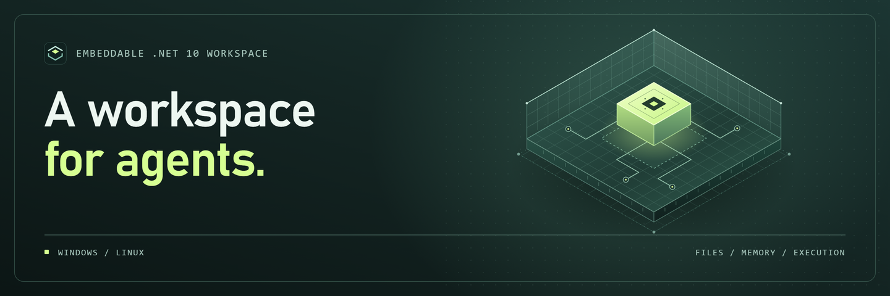

# AgentSpace



AgentSpace is an embeddable .NET 10 workspace for agents on Windows and Linux. A workspace belongs to one tenant and one agent. It provides physical file storage, Markdown and skill discovery, short-term memory, durable MAGICore memory, a JSON document database, and a restricted script interpreter.

## Build and run

```sh
git submodule update --init --recursive
dotnet build AgentSpace.slnx
dotnet run --project examples/AgentSpace.Example
dotnet run --project tests/AgentSpace.Tests
```

Reference `AgentSpace.Infrastructure` for the host and built-in runtime. Reference `AgentSpace.MagiCore` and register `MagiCoreMemoryProvider` to enable long-term memory. The core projects use the .NET base class library and Windows or Linux filesystem primitives. The MAGICore project reference brings the upstream project's .NET package dependencies. It uses local embeddings and needs no hosted model or database.

## Configure access in the host

```csharp
using AgentSpace;

var policy = new WorkspacePolicy
{
    Files =
    [
        new("knowledge/**", FileAccessRights.Read | FileAccessRights.Search),
        new("output/**", FileAccessRights.All)
    ],
    Networks = [new("https", 443, "GET", "v1/**", Host: "api.example.com")],
    Commands = [new("text.upper", ["report-*"])],
    AllowScripts = true,
    AllowDatabase = true,
    AllowShortTermMemory = true,
    AllowLongTermMemory = true,
    Limits = new WorkspaceLimits { MaxConcurrentRuns = 1, MaxScriptSteps = 2_000 }
};

var host = new AgentSpaceHost(dataDirectory,
    new DelegateWorkspacePolicyProvider(identity => ResolvePolicies(identity, policy)),
    commands: new Dictionary<string, AgentCommand>
    {
        ["text.upper"] = new(args => args.Count == 1,
            (_, args, _) => Task.FromResult(args[0].ToUpperInvariant()))
    },
    longTermMemory: new MagiCoreMemoryProvider());

IAgentWorkspace workspace = host.Open(authenticatedIdentity);
```

The embedding application authenticates callers, resolves policies in `ResolvePolicies`, and gives the agent only its bound `IAgentWorkspace`. The provider returns a tenant policy and can supply a narrower agent policy. An optional run policy further narrows access. Each layer must grant an operation, and the smallest configured limit applies. The provider can return new policies while the process is running. AgentSpace checks current policy at protected operations, including script publication. Host applications sharing a workspace across processes must supply consistent identities and policies.

| Rule | Behavior |
| --- | --- |
| Files | Paths are case-sensitive and relative to the workspace. They use `/` and portable ASCII segments. `*` and `?` match within a segment. A whole `**` segment matches zero or more segments. Moves and copies check both paths. Text search requires read and search access. Skills are folders containing `SKILL.md`. |
| Network | Requests are limited to HTTP(S). Rules match scheme, port, method, path, and hostname or CIDR. Host rules can use `*.example.com`. A hostname rule without a CIDR permits public addresses only. A CIDR-only rule matches IP literals. For an internal DNS name, configure both its hostname and its address range. Connections use the validated address, and allowed redirects are checked again. |
| Commands | Each rule matches a registered command name and can specify one glob per argument. Omitting argument patterns leaves validation to the registered command. An empty pattern list permits zero arguments. Handlers are trusted C# code running with host privileges. Use the supplied command context for policy-checked file and HTTP operations, and honor its cancellation token. |
| Limits | `WorkspaceLimits` controls file and document sizes and counts, memory retention, active runs, execution time and steps, script value memory, output, network requests and bodies, and journal size. |

## Run a script

Call `RunScriptAsync` with script text or `RunScriptFileAsync` with a readable workspace path. The interpreter accepts one instruction per line, JSON-quoted strings, bare values, `$variable` references, and `#` comments. It exposes only its built-in instructions and host-registered commands.

```text
read notes "knowledge/summary.md"
concat heading "# Report\n\n" $notes
if $notes ""
  print "No notes"
else
  write "output/report.md" $heading
  print "Saved report"
end
```

Other instructions are `set name value`, `repeat count` with `end`, `call result command [arguments...]`, and `fetch result method url [body]`. Script file changes are staged and published together after a successful run. If a referenced file changes concurrently, publication fails with `WorkspaceConflictException`. Authorized HTTP requests and any external effects from trusted commands occur when invoked.

## Storage and concurrency

- `Files` stores binary content in checksummed physical blobs. Logical paths and revisions live in the journal. File listing and search return cursor-based pages. Content search covers supported UTF-8 text formats up to 1 MiB per file.
- `Database` stores JSON values in named collections. Use `ApplyAsync` for atomic batches and `QueryAsync` for key-ordered pagination and optional top-level property equality. Use expected revision `0` for a missing or expired item, and a current positive revision for an update. A `null` `DocumentChange.Value` deletes a document. A JSON null is a stored value.
- `ShortTermMemory` stores ordered entries per session with expiration. `LongTermMemory` uses MAGICore for local recall and stores its records and audit history in a private journal namespace. `ForgetAsync` removes a memory from recall while retaining its audit history.
- A filesystem lease serializes storage operations per workspace across local processes. Independent workspaces can operate concurrently. Transactions are checksummed and flushed before acknowledgement. Recovery drops incomplete trailing frames and reports checksum errors in complete frames. `AgentSpaceHost.CompactAsync` rewrites a verified snapshot and collects obsolete blobs.

Use a host-owned data directory on a local filesystem. The library coordinates processes on one machine. Give filesystem access to the trusted host account and expose workspace operations to agents through the bound API.

## Project layout

| Project | Responsibility |
| --- | --- |
| `AgentSpace.Domain` | Workspace identity, path validation, and errors |
| `AgentSpace.Application` | Workspace contracts, policies, and capability types |
| `AgentSpace.Infrastructure` | Host, custom database, physical files, policy enforcement, and interpreter |
| `AgentSpace.MagiCore` | Durable adapter for the pinned MAGICore submodule |

## License

AgentSpace is licensed under the [Apache License 2.0](LICENSE).
